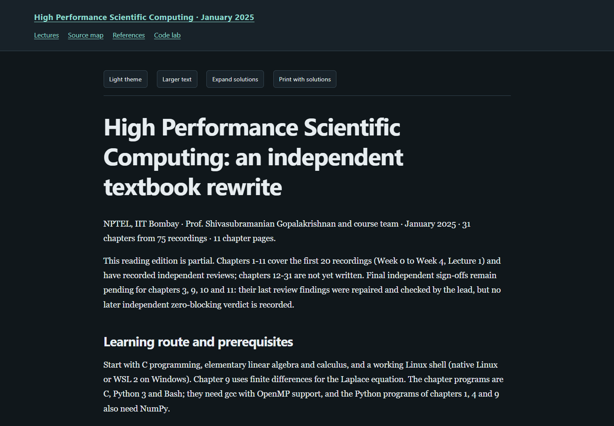

# High Performance Scientific Computing — a textbook rewrite

**[Read the live textbook](https://az9713.github.io/nptel-high-performance-scientific-computing-notes/)**

[](https://az9713.github.io/nptel-high-performance-scientific-computing-notes/)

This project is an independent rewrite and expansion of Prof. Shivasubramanian
Gopalakrishnan's NPTEL IIT Bombay course, **High Performance Scientific Computing**.
The **[January 2025 YouTube playlist](https://www.youtube.com/playlist?list=PLOzRYVm0a65fSrgx3kroerFJtFjGGIcXm)
serves as the spine**: it sets the topic sequence and provides timestamped
anchors for the exposition.

Around that spine, the project develops explanations, definitions, derivations,
measurements, runnable C, Python and Bash programs, and worked problems. Source
maps distinguish lecture material, research extensions, and original teaching
constructions. Chapter citations and sidecars record source uncertainties and
claims that could not be checked.

**This is a partial edition.** Chapters **1–20** are written and independently reviewed; chapters **21–31** remain pending.

The plan groups **75 source recordings** (playlist items 2–76) into **31 topic chapters**; the separate course trailer is excluded. The written chapters cover **44 recordings** and contain **120 expandable worked solutions** and **196 runnable listings** (26 Bash, 103 C, 14 CUDA C++, 53 Python). The lecture index records each recording assignment and any remaining work.

Transcripts were produced locally with faster-whisper small.en; they are machine transcriptions, not publisher captions. The NPTEL caption tracks are attached to the wrong videos and were not used.

The reader includes searchable chapter navigation, local MathJax, light/dark
themes, adjustable text size, expandable solutions, printing with solutions,
and a code-lab directory and launcher for the chapter programs. Rendering
assets are bundled, so a downloaded copy also works offline.

Explore the [source map](https://az9713.github.io/nptel-high-performance-scientific-computing-notes/source-map.html),
[primary references](https://az9713.github.io/nptel-high-performance-scientific-computing-notes/references.html),
and [code lab](https://az9713.github.io/nptel-high-performance-scientific-computing-notes/code-lab.html).
The preview above opens the live GitHub Pages edition, served from `index.html`.

## Run locally

Open `index.html` after downloading the repository. To rebuild and check it:

```sh
python tools/build_book.py
python tools/validate_books.py --browser
python code_lab.py
python code_lab.py --chapter 9
python tools/check_chapter_code.py
python tools/check_package.py
```

Rebuilding and static checks use Python's standard library. The chapter
programs run in a Linux shell: natively on Linux, or through WSL 2 on Windows
(`code_lab.py` calls `wsl`; set `HPSC_WSL_DISTRO` if the distribution is not
named `Ubuntu`). They need gcc with OpenMP support; the Python programs of
chapters 1, 4 and 9 also need NumPy. Browser checks require Python Playwright
and an installed supported browser.

Additional toolchains are identified by each listing. MPI examples require an MPI compiler wrapper and launcher, such as mpicc and mpirun. Chapters using CUDA or OpenACC require the stated compiler/offload runtime and a compatible GPU; profiling and debugging examples require the named tools.

All runs and timings made for these chapters come from one laptop (the lecture
screens analysed in the text come from the lecturer's machines): an Intel Core i5-12450H
(4 performance cores with 2 hardware threads each and 4 efficiency cores, 12
logical CPUs), an NVIDIA GeForce RTX 3050 Laptop GPU, WSL 2 Ubuntu 24.04 and
gcc 13.3. Timings, bandwidths and speedups differ on other machines. Listings
whose output depends on timing or thread interleaving are checked for a
successful exit only; the others are checked byte for byte.

## Evidence and scope

Every written chapter has at least two recorded independent review rounds. The latest recorded review of every written chapter has zero blocking findings; all remaining findings were repaired and checked. Historical verdicts remain unchanged in the editorial record. Chapters requiring more than two rounds (chapter: rounds): 3: 3, 9: 4, 10: 5, 11: 4, 12: 3, 15: 3.

Execution evidence is cumulative. Chapters 1–12 retain their original dated runs from the pinned historical source, with all current listing inputs checked for identity; they were not rerun under the later workspace-only policy. Chapters 13 onward record fresh workspace-contained runs. Each chapter keeps its own execution timestamp and environment profile. A successful run checks the stated finite example, not the general scientific claim.

The [workflow](WORKFLOW.md), [source record](source-validation-summary.json),
[editorial record](editorial-review-summary.json), [content inventory](completion.json),
[code checks](chapter-code-validation.json), [reader checks](reader-validation.json),
[clean-export checks](source-free-validation.json), and [package checks](package-validation.json)
record the evidence and its limits. Code checks report execution and
printed-output agreement separately from scientific acceptance. Reader checks
assess rendering and controls, not mathematical correctness. A whole-book
scientific review, full audiovisual review, and human accessibility
certification are not claimed. The [publication check](publication-validation.json)
records served-file integrity of the live GitHub Pages edition.

Public files contain the rewritten textbook, supporting code, source citations,
and curated verification records. Raw recordings, transcripts, slide frames,
downloaded papers, and private editorial records (author briefs and review
reports) remain outside this repository. Published instructor and
research-author names are retained for source attribution. GitHub Pages serves
the `main` branch at the repository root, matching the other NPTEL reading
editions.
